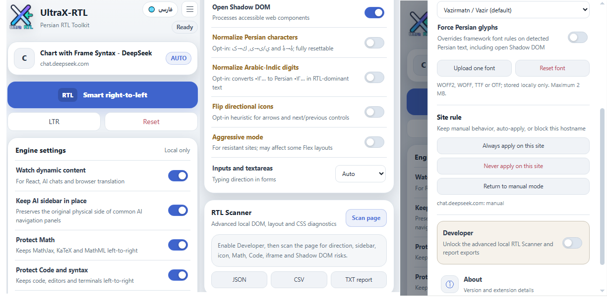
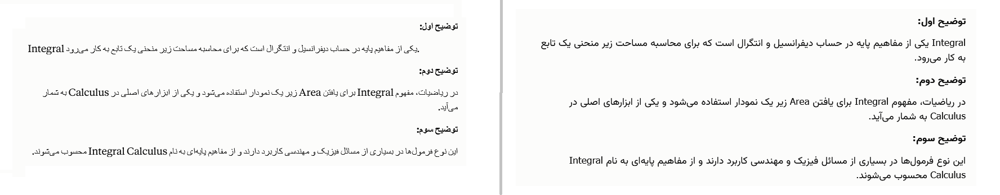
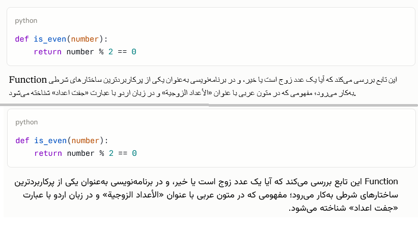
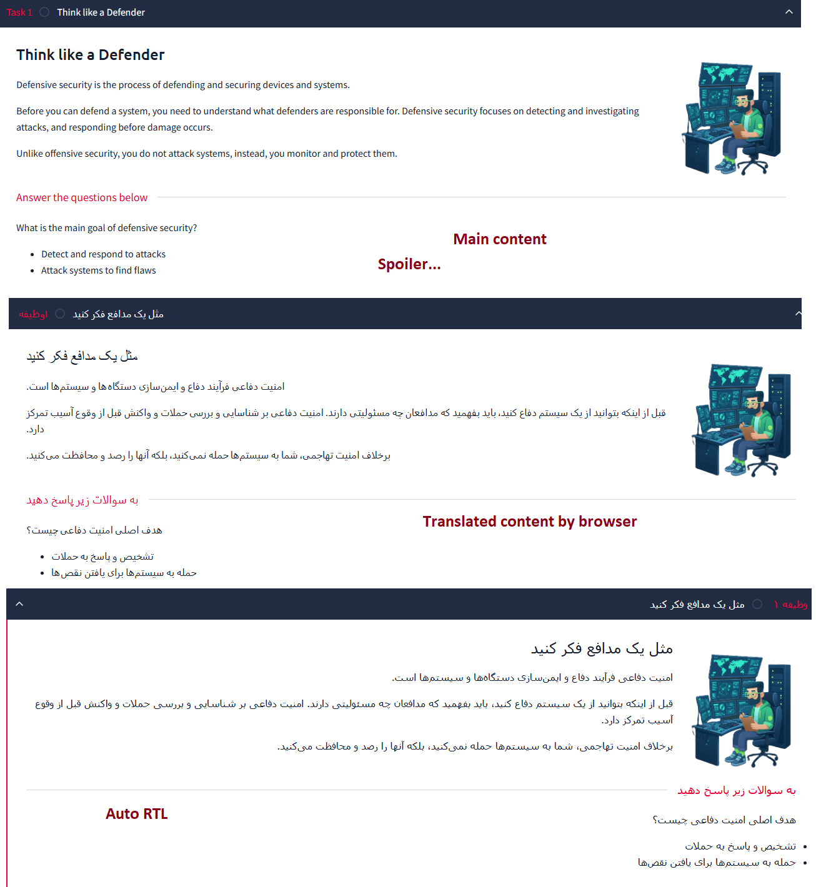

  

  <h1>UltraX-RTL</h1>

  
<strong>Professional right-to-left rendering for RTL web content and AI conversations.</strong>

  

    <a href="https://github.com/Mr-T3st/UltraX-RTL/releases/latest"><strong>Download latest release</strong></a>
  

  

    
    
    
    
  

---

UltraX-RTL is a cross-browser extension built for content written in right-to-left languages, browser-translated pages, and modern AI chat interfaces. It applies RTL only where it is useful, keeps technical content readable, preserves page structure, and lets the user restore the original layout at any time.

The extension runs locally in the browser. It does not use analytics, tracking, remote scripts, or a server for processing page content.

## Why UltraX-RTL?

Changing the direction of an entire page is easy. Doing it without breaking code blocks, formulas, sidebars, editors, mixed-language sentences, and dynamic chat responses is not.

UltraX-RTL treats these parts independently. Persian prose can become RTL while code, mathematics, URLs, technical labels, and interface controls retain the direction they need.

UltraX-RTL is not tied to a specific website, AI service, or front-end framework. Its DOM-based engine adapts to standard page structures, dynamic single-page applications, and accessible web components, allowing reliable RTL processing across a broad range of websites without site-specific integration.

## Demo

These examples show the extension interface, Persian text correction, protected LTR code, and RTL handling for browser-translated content. Select the thumbnail strip to expand or collapse the full-size gallery on this page.

  

    
    
    
    
  

   

  
<strong>Extension controls and local configuration</strong>

  

    
  

  
<strong>Element-level Persian RTL correction</strong>

  

    
  

  
<strong>LTR code protection inside Persian content</strong>

  

    
  

  
<strong>Automatic RTL for browser-translated content</strong>

  

    
  

## Key features

### Smart Persian direction

- Detects RTL-dominant text at element level.
- Handles mixed Unicode text and English paragraphs more naturally.
- Supports sentences that begin with an English product name or technical phrase.
- Processes content added later by single-page applications and streaming AI responses.
- Restores extension-owned changes through Reset.

### AI sidebar preservation

- Keeps a detected sidebar on its original physical side while the conversation becomes RTL.
- Uses semantic, structural, and geometry-based detection instead of relying only on class names.
- Handles interfaces that generate hashed or frequently changing class names.
- Reports when a sidebar cannot be detected so the result can be included in a Scanner export.
- Can be disabled when the website's own RTL layout should control sidebar placement.

### Technical-content protection

- Keeps code blocks and syntax-highlighted content LTR.
- Protects terminal output, line numbers, editors, and inline technical fragments.
- Supports common rendering environments such as Highlight.js, Prism, Shiki, Monaco, CodeMirror, ACE, and xterm.
- Keeps MathML, MathJax, and KaTeX content isolated from page-level RTL changes.
- Distinguishes prose written inside a Markdown fence from an actual programming-language block when enough evidence is available.

### Persian typography

- Includes Vazirmatn as the default Persian font.
- Can force the selected font onto Persian text that was added by browser translation or a JavaScript framework.
- Provides system-font alternatives when compatible fonts are installed.
- Accepts one private local WOFF2, WOFF, TTF, or OTF font.
- Stores an uploaded font locally and never sends it to a remote service.
- Includes a font reset that returns typography to the bundled default.

### Optional text cleanup

- Can normalize common Arabic variants of Persian characters on RTL-dominant text.
- Provides a separate option for converting Arabic-Indic digits to Persian digits.
- Keeps both options disabled by default because they modify text nodes.
- Records original values so supported changes can be restored.

### Directional controls and domain rules

- Can mirror likely Next, Previous, Arrow, and Chevron icons without rewriting SVG content.
- Provides Always, Manual, and Never behavior per hostname.
- Keeps domain rules local to the browser.
- Does not request permanent access to every website.

### Developer Scanner

- Runs only after Developer mode is enabled inside the extension.
- Shows concise recommendations instead of filling the popup with raw diagnostics.
- Detects relevant page conditions such as unhandled RTL text, protected technical regions, sidebars, directional icons, translated content, and accessible Shadow DOM.
- Exports complete JSON, CSV, or TXT reports locally.
- Makes it easier to diagnose a difficult website without granting remote diagnostic access.

### Modern interface

- Supports light and dark appearance modes.
- Includes Aurora, Ocean, Rose, and Graphite palettes.
- Uses readable Persian and English font stacks.
- Keeps important controls accessible from a compact hamburger menu.

## Privacy by design

UltraX-RTL is designed around temporary, user-authorized access.

| Area | Behavior |
|---|---|
| Page analysis | Performed locally in the active tab |
| Analytics | Not used |
| Tracking | Not used |
| Remote executable code | Not used |
| Permanent host access | Not requested |
| Custom font | Stored locally in the browser |
| Scanner report | Created locally and downloaded only on request |
| Synced preferences | Limited to small user settings supported by browser sync |

The extension uses `activeTab`, `scripting`, and `storage`. These permissions provide temporary page access after a user action, load the local RTL engine, and retain user preferences.

See [PRIVACY_POLICY.md](PRIVACY_POLICY.md) for the full policy used by the browser-store listings.

## Downloads

Open the [latest GitHub Release](https://github.com/Mr-T3st/UltraX-RTL/releases/latest) and select the package for your browser.

| Browser | Release asset | Intended use |
|---|---|---|
| Google Chrome | `ultrax-rtl-chrome-v2.8.0.zip` | Local unpacked installation or Chrome Web Store submission |
| Microsoft Edge | `ultrax-rtl-edge-v2.8.0.zip` | Local unpacked installation or Edge Add-ons submission |
| Mozilla Firefox | `ultrax-rtl-firefox-v2.8.0.zip` | Temporary testing or Mozilla Add-ons submission |
| All packages | `SHA256SUMS.txt` | Download-integrity verification |

## Installation

### Google Chrome

1. Download `ultrax-rtl-chrome-v2.8.0.zip` from Releases.
2. Extract it to a permanent folder.
3. Open `chrome://extensions`.
4. Enable **Developer mode**.
5. Select **Load unpacked**.
6. Choose the extracted folder containing `manifest.json`.
7. Pin UltraX-RTL from the Extensions menu.

Chrome normally keeps an unpacked extension after restart. It may stop loading if the extracted folder is moved, deleted, or blocked by an organization policy.

### Microsoft Edge

1. Download and extract `ultrax-rtl-edge-v2.8.0.zip`.
2. Open `edge://extensions`.
3. Enable **Developer mode**.
4. Select **Load unpacked**.
5. Choose the extracted folder containing `manifest.json`.
6. Pin UltraX-RTL from the Extensions menu.

### Mozilla Firefox

For temporary testing:

1. Download and extract `ultrax-rtl-firefox-v2.8.0.zip`.
2. Open `about:debugging#/runtime/this-firefox`.
3. Select **Load Temporary Add-on**.
4. Choose `manifest.json` from the extracted folder.

Firefox removes temporary add-ons when the browser closes. Permanent installation requires a Mozilla-signed package.

## Store availability

| Store | Status | Link |
|---|---|---|
| Chrome Web Store | Preparing for publication | — |
| Microsoft Edge Add-ons | Preparing for publication | |
| Mozilla Add-ons | Preparing for publication | |

The Edge and Mozilla link fields are intentionally left blank until their public listings are available.

## Basic usage

1. Open a Persian page, translated page, or AI conversation.
2. Select the UltraX-RTL toolbar icon.
3. Choose **Smart RTL**.
4. Adjust Sidebar, Font, Math, Code, or advanced options only when needed.
5. Select **Reset** to restore extension-owned changes.

The default configuration is intended to be safe for ordinary Persian content. Character normalization and directional-icon flipping remain opt-in because they can produce false positives on unusual pages.

## Important settings

| Setting | Purpose | Default |
|---|---|---|
| Watch dynamic content | Processes new and streamed content | On |
| Preserve sidebar | Keeps the detected sidebar on its original side | On |
| Protect Math | Keeps supported formulas LTR and isolated | On |
| Protect Code | Keeps code, editors, and terminals LTR | On |
| Force Persian font | Applies the selected Persian font more strongly | On |
| Normalize characters | Converts selected Arabic variants on RTL text | Off |
| Normalize digits | Converts Arabic-Indic digits on RTL text | Off |
| Flip directional icons | Mirrors likely directional controls | Off |
| Aggressive mode | Broadens RTL targeting on difficult layouts | Off |

## Scanner reports

When a page still renders incorrectly:

1. Open the UltraX-RTL menu.
2. Enable **Developer**.
3. Run **Scan**.
4. Apply any relevant recommendation shown in the popup.
5. Export the TXT report if the problem remains.
6. Keep the exported report for local troubleshooting or future analysis.

The popup intentionally avoids displaying the complete raw scan. Detailed evidence remains available through local export.

## Compatibility

UltraX-RTL targets current versions of Chrome, Edge, and Firefox using Manifest V3 and is designed for broad compatibility across conventional websites, browser-translated pages, and modern web applications.

Like every browser extension, it operates within the browser's security model. Browser-protected pages, cross-origin frames, and closed Shadow DOM may prevent extensions from accessing isolated content; these are platform restrictions rather than dependencies on particular websites or frameworks. The Scanner report helps document exceptional rendering cases.

## Project links

- Repository: [github.com/Mr-T3st/UltraX-RTL](https://github.com/Mr-T3st/UltraX-RTL)
- Releases: [github.com/Mr-T3st/UltraX-RTL/releases](https://github.com/Mr-T3st/UltraX-RTL/releases)

---

  <strong>UltraX-RTL</strong> 
  Clear right-to-left text. Protected technical content. Original layout when it matters.

